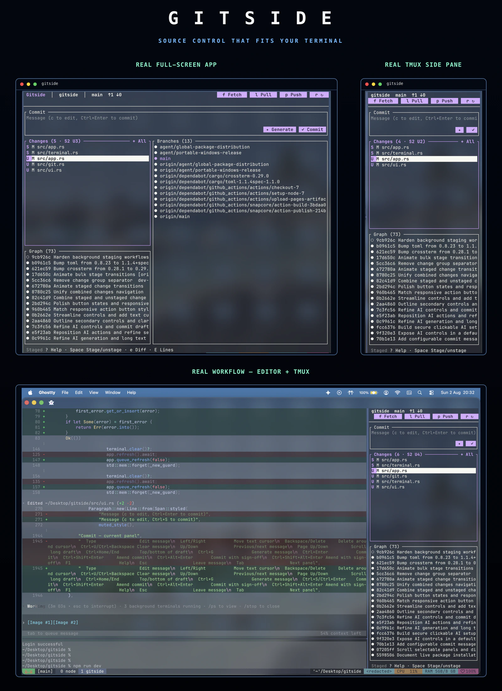

<p align="center">
  
</p>

<p align="center"><sub>Real Gitside sessions: narrow pane, wide terminal, and a live Ghostty/tmux workflow.</sub></p>

<p align="center"><strong>Source control that fits your terminal.</strong></p>

<p align="center">
  A fast, mouse-friendly Git interface inspired by VS Code Source Control,<br />
  designed for full screens, narrow tmux panes, and everything between.
</p>

<p align="center">
  <a href="https://github.com/dev-bhaskar8/gitside/actions/workflows/ci.yml"></a>
  <a href="https://github.com/dev-bhaskar8/gitside/blob/main/LICENSE"></a>
  <a href="https://www.rust-lang.org"></a>
  <a href="https://github.com/dev-bhaskar8/gitside/stargazers"></a>
</p>

<p align="center">
  <a href="https://dev-bhaskar8.github.io/gitside/"><strong>Website</strong></a> ·
  <a href="https://dev-bhaskar8.github.io/gitside/docs/"><strong>Documentation</strong></a> ·
  <a href="CONTRIBUTING.md"><strong>Contributing</strong></a>
</p>

---

## Install

Prebuilt packages are published for macOS, Linux, and Windows with each stable
release. Git 2.30+ is required at runtime.

Version 0.2.0 is available through Cargo, GitHub Releases, Homebrew, Scoop, AUR,
and the Nix source package. npm currently serves 0.1.2.
See the [channel status](docs/distribution.md).

### Cross-platform

#### npm

```sh
npm install --global gitside
```

The npm package installs the matching native binary.

#### Cargo

```sh
cargo install gitside --locked
```

Cargo builds Gitside from source. Use the current stable Rust toolchain. Linux builds
also need `pkg-config` and D-Bus development headers (`libdbus-1-dev` on Debian/
Ubuntu, `dbus-devel` on Fedora).

### macOS and Linux

```sh
# Homebrew
brew install dev-bhaskar8/tap/gitside
```
### Windows

#### Scoop

```powershell
scoop bucket add gitside https://github.com/dev-bhaskar8/scoop-bucket
scoop install gitside
```

### Arch Linux and Nix

```sh
# Arch User Repository
paru -S gitside-bin

# Run the source package with Nix
nix run github:dev-bhaskar8/gitside
```

### Direct downloads

macOS, Linux, and Windows installers, portable archives, `.deb`, `.rpm`, and `.snap`
packages are available from
[GitHub Releases](https://github.com/dev-bhaskar8/gitside/releases/latest).
Native archives and Linux packages carry GitHub provenance attestations.
See the [installation matrix](docs/distribution.md#installation-matrix) for
package versions, architecture support, and publication status. Chocolatey,
WinGet, and Snap are configured distribution targets and have separate store
approval or account requirements.

Pass a repository path from anywhere:

```sh
gitside /path/to/repository
```

## Why Gitside?

- **Made for side panes.** Changes and history remain useful in tall, narrow tmux layouts.
- **Mouse and keyboard.** Click controls in Ghostty and other SGR-capable terminals, or operate everything without a mouse.
- **A complete daily Git loop.** Stage files or hunks, commit, inspect history, manage branches, stash, sync, resolve conflicts, and work with worktrees.
- **GitHub when you need it.** Publish a repository, browse pull requests and issues, check out PRs, and inspect checks through the authenticated `gh` CLI.
- **Your terminal, your colors.** Gitside inherits the terminal background instead of painting an opaque theme over it.
- **Responsive and non-blocking.** Network work runs in the background and filesystem notifications keep repository state fresh.
- **Optional commit drafts.** Configure offline rules, Codex, Claude Code, OpenCode, Antigravity, Cursor, Grok Build, Pi, Muse Code, another ACP agent, a custom command, or a direct API inside the clickable AI panel. API keys stay in the OS keychain.

### AI commit drafts (optional)

Click Generate or press `Ctrl+G` to choose Codex, Claude Code, OpenCode,
Antigravity, Cursor, Grok Build, Pi, Muse Code, or another installed ACP agent.
Gitside remembers the choice and uses the CLI's saved login and default model.
Installation detection checks the executable; provider requests check account access.
These integrations ship in 0.2.0. Install through an updated channel or build
the tagged source; the [installation matrix](docs/distribution.md#installation-matrix)
tracks each package registry separately.

Antigravity has an integrated setup flow: choose it in Configure, select
**Install Antigravity**, then **Sign in with Google**. Gitside installs a verified,
compatible runtime, opens Google sign-in, and loads your account's models. Its
saved sign-in is separate from `agy` and the IDE. No separate API key is required
for these account-based routes.

| Provider | Sign in before generating |
| --- | --- |
| Codex | `codex login` |
| Claude Code | `claude auth login` |
| OpenCode | `opencode auth login` |
| Cursor | Install Cursor CLI (`cursor-agent`), then `agent login` |
| Grok Build | `grok login` |
| Pi | Start `pi`, then `/login` |
| Muse Code | `muse login` |
| Antigravity | Configure → Install Antigravity → Sign in with Google |

Other ACP agents accept an executable, arguments, and an optional advertised
authentication method. Offline rules, trusted custom commands, and direct
OpenAI, Anthropic, Gemini, OpenRouter, or compatible APIs remain available.

Press `Y` to change the CLI, set an optional model or instructions, or explicitly
choose offline rules or a direct API. Generation uses staged changes, falling
back to the working tree when nothing is staged. It times out after 120 seconds
and preserves drafts edited while waiting. See the
[AI configuration guide](docs/configuration.md#commit-message-generation).

## Same-repository benchmark

To compare the launch experience directly, I ran Gitside, lazygit, gitui, and
tig against this checkout (87 commits) in the same 118×42 tmux terminal on
macOS arm64. These are the medians of five launches. Time is measured to the
first usable screen, memory is process RSS at that point, and every run was
quit with `q`.

| Tool | Time to first UI | Memory (RSS) | Binary | Stability |
| --- | ---: | ---: | ---: | --- |
| `gitside` 0.1.2 | **0.75 s** | **10 MiB** | 5.2 MB | 5/5 clean exits |
| `gitui` 0.28.1-nightly | 0.16 s | 15 MiB | 10.0 MB | 5/5 clean exits |
| `lazygit` 0.63.1 | 0.27 s | 30 MiB | 18.6 MB | 5/5 clean exits |
| `tig` 2.6.1 | 0.15 s | 3.5 MiB | 0.7 MB | 5/5 clean exits |

These are historical 0.1.2 measurements from August 3, 2026; they have not been
rerun for the 0.2.0 AI changes. This is an interactive launch comparison, not a
full-history stress test.
Gitside loads a bounded history page initially and fetches more commits as you
scroll, so a 900k-commit repository should be benchmarked separately before
drawing conclusions about large-repository performance.

## Essential controls

| Key | Action | Key | Action |
| --- | --- | --- | --- |
| `j` / `k` | Move | `Tab` | Next panel |
| `Space` | Stage / unstage | `Enter` | Open / activate |
| `c` | Commit message | `Ctrl+S` / `Ctrl+Enter` | Commit |
| `Ctrl+U` / `Ctrl+Backspace` | Clear commit draft | `Ctrl+G` | Generate message draft |
| `Y` | Open AI panel | `f` / `l` / `p` | Fetch / pull / push |
| `r` | Refresh | `g` / `b` / `h` | Graph / branches / GitHub |
| `/` | Search panel | `?` / `F1` | Contextual help |
| `q` / `Ctrl+C` | Quit |  |  |

The interface exposes specialized shortcuts only when they apply. See the
[complete controls](docs/controls.md) for conflict resolution, line staging,
worktrees, stashes, advanced commits, and remote workflows.

## GitHub publishing

Install and authenticate [GitHub CLI](https://cli.github.com/), then press `p`
when the repository has no remote. Gitside asks for the repository name,
visibility, and final confirmation before creating anything. It never creates
or pushes a remote repository automatically.

## Documentation

- [Getting started](https://dev-bhaskar8.github.io/gitside/docs/)
- [Controls](docs/controls.md)
- [Configuration](docs/configuration.md)
- [Platform support](docs/platforms.md)
- [Troubleshooting](docs/troubleshooting.md)
- [Architecture](docs/architecture.md)
- [Packages and releases](docs/distribution.md)

## Support Gitside

If Gitside saves you time, you can support its development using this EVM
wallet address:

```text
0xC87efC9c71C422779F7dbeF14B2Fc4eef94b84fF
```

Verify that your chosen network and asset are compatible before sending.
Cryptocurrency transfers cannot be reversed. See [support details](docs/support.md).

## Development

Build and install the current checkout locally:

```sh
cargo install --locked --path . --force
```

Before preparing a release:

```sh
cargo fmt --check
cargo clippy --all-targets -- -D warnings
cargo test --locked
scripts/check-release-metadata.sh
scripts/test-packaging.sh
scripts/check-release-workflow.sh
```

The architecture keeps Git and AI work behind asynchronous adapters. The TUI
owns input, rendering, and editable drafts; coding CLIs own authentication and
model requests. Generation only returns text to the editor. See the detailed
[architecture](docs/architecture.md).

| Path | Responsibility |
| --- | --- |
| `src/app.rs`, `src/ui.rs`, `src/terminal.rs` | Actions, rendering, event loop |
| `src/ai.rs`, `src/ai/commit.rs` | Git context, shared commit schema, and message cleanup |
| `src/ai/provider.rs`, `src/ai/provider/acp.rs`, `src/ai/provider/rpc.rs` | CLI/API adapters, ACP sessions, Pi RPC, and Muse MSP |
| `src/ai/provider/antigravity_install.rs` | Verified managed runtime installation and automatic discovery |
| `src/git.rs`, `src/github.rs` | Git and GitHub CLI operations |
| `src/config.rs`, `src/credentials.rs` | Settings and OS credential storage |
| `docs/` | Configuration, architecture, platform and distribution guides |
| `scripts/`, `packaging/` | Installers, package manifests and release checks |

Read [CONTRIBUTING.md](CONTRIBUTING.md) before opening a pull request. Security
issues should follow [SECURITY.md](SECURITY.md).

## License

MIT © Gitside contributors
